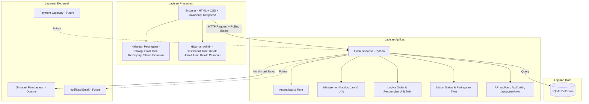
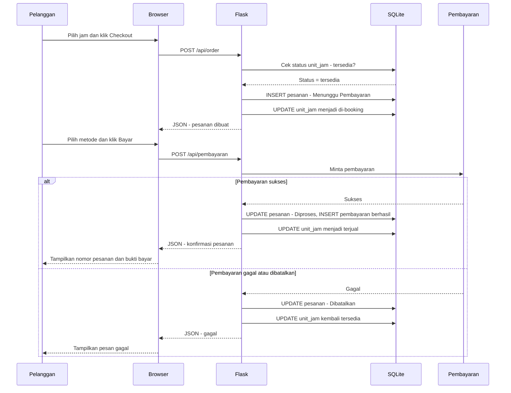
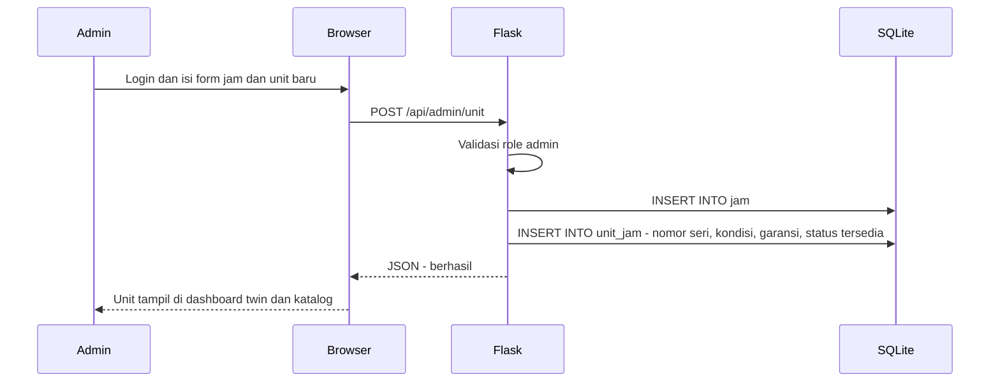
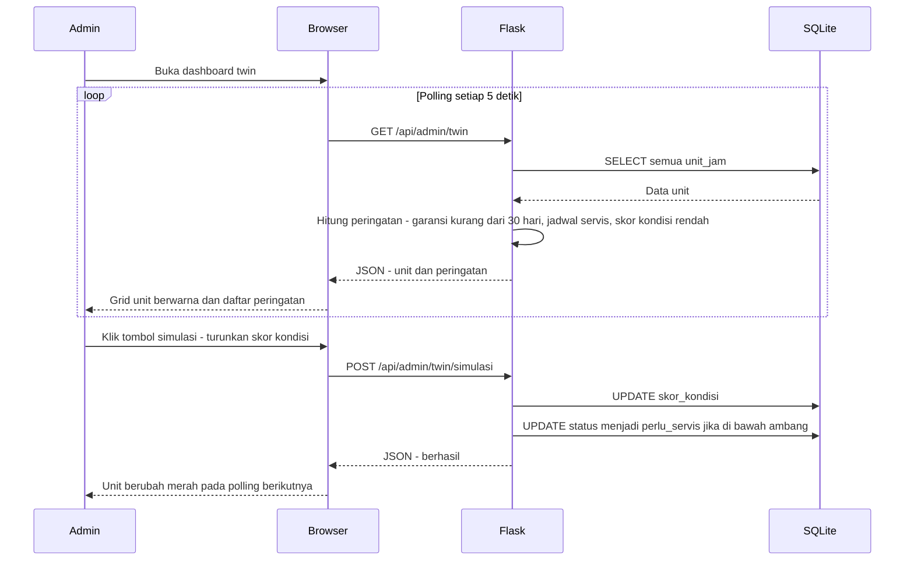
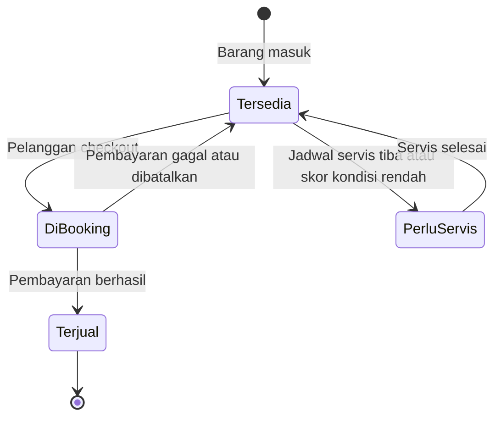
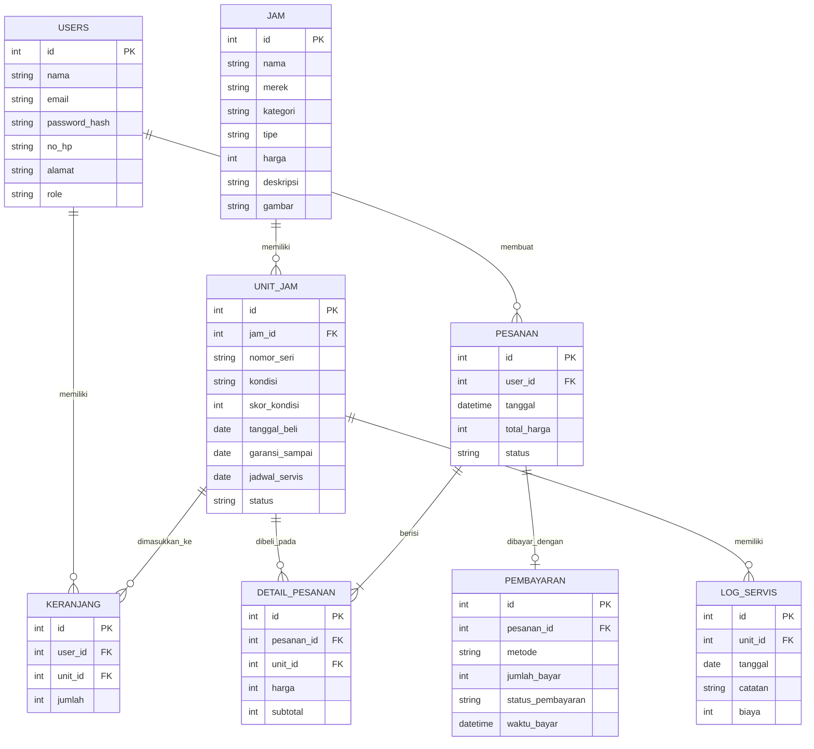

# ARSITEKTUR SISTEM — NEXUS Time (Toko Jam Tangan Online dengan Digital Twin)

## 1. Diagram Arsitektur

## 2. Penjelasan Layer

| Layer | Komponen | Fungsi |
|-------|----------|--------|
| **Presentasi** | HTML, CSS, JavaScript | Menampilkan katalog jam, profil digital twin, keranjang, dan dashboard admin. Tampilan responsif untuk desktop dan HP |
| **Aplikasi** | Flask (Python) | Memproses request, autentikasi, logika order, penguncian unit, serta perhitungan status dan peringatan twin |
| **Data** | SQLite | Menyimpan data user, jam, unit twin, pesanan, pembayaran, dan log servis |
| **Layanan Eksternal** | Simulasi Pembayaran / Payment Gateway | Memproses dan mengonfirmasi pembayaran |

## 3. Alur Komunikasi

### 3.1 Alur Pembelian Jam (Status Twin Berubah Otomatis)

### 3.2 Alur Admin Menambah Jam dan Unit Twin

### 3.3 Alur Pemantauan dan Peringatan Twin

## 4. Siklus Status Digital Twin

## 5. Rancangan Tabel Database

## 6. Daftar Endpoint API

| Method | Endpoint | Akses | Fungsi |
|--------|----------|-------|--------|
| POST | `/api/auth/register` | Publik | Registrasi pelanggan |
| POST | `/api/auth/login` | Publik | Login dan pengarahan sesuai role |
| GET | `/api/jam` | Publik | Katalog jam dengan filter kategori, tipe, harga |
| GET | `/api/jam/<id>` | Publik | Detail jam, daftar unit, dan profil twin |
| GET/POST/DELETE | `/api/keranjang` | Pelanggan | Lihat, tambah, dan hapus item keranjang |
| POST | `/api/order` | Pelanggan | Checkout dan kunci unit twin menjadi di-booking |
| POST | `/api/pembayaran` | Pelanggan | Bayar (simulasi) dan ubah status twin |
| GET | `/api/order/saya` | Pelanggan | Status dan riwayat pesanan |
| POST/PUT/DELETE | `/api/admin/unit` | Admin | Kelola jam dan unit twin |
| GET | `/api/admin/twin` | Admin | Dashboard twin dan peringatan |
| POST | `/api/admin/twin/simulasi` | Admin | Simulasi perubahan kondisi unit |
| GET/PUT | `/api/admin/pesanan` | Admin | Daftar pesanan dan ubah status |

## 7. Teknologi yang Digunakan

| Komponen | Teknologi | Alasan |
|----------|-----------|--------|
| Backend | Flask | Ringan, mudah dipelajari |
| Database | SQLite | Tidak perlu server, portable |
| Frontend | HTML + CSS + JavaScript | Sederhana, responsif untuk HP dan desktop |
| Sinkronisasi Twin | Polling `fetch` setiap 5 detik | Sederhana, status unit tetap terasa real-time |
| Keamanan | Werkzeug (hash password) + session | Password tidak disimpan sebagai teks biasa |
| Pembayaran | Simulasi (dummy) | Bisa didemokan tanpa akun merchant |
| Version Control | Git + GitHub | Standar industri |
| Diagram | Mermaid | Render langsung di GitHub |

## 8. Kelebihan Arsitektur Ini

- **Digital Twin Jelas** - Satu jam fisik sama dengan satu baris `unit_jam`, sehingga identitas dan kondisi tiap unit terpantau
- **Modular** - Setiap layer terpisah, mudah dikembangkan
- **Tanpa Layanan Berbayar** - Bisa jalan dengan simulasi pembayaran dan SQLite
- **Aman** - Ada pemisahan role (pelanggan/admin) dan password ter-hash
- **Mencegah Pemesanan Ganda** - Unit dikunci "di-booking" lewat satu query atomik (`UPDATE ... WHERE status='tersedia'`)
- **Future-proof** - Siap diintegrasikan dengan payment gateway (mis. Midtrans) dan email notifikasi
