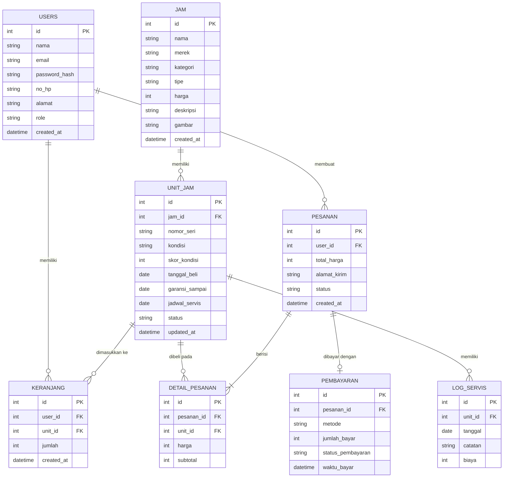

# ENTITY RELATIONSHIP DIAGRAM (ERD)
## NEXUS Time — Toko Jam Tangan Online dengan Digital Twin

## 1. Diagram ERD

> **Digital twin** berada pada tabel `unit_jam`: satu baris mewakili satu jam tangan fisik, lengkap dengan identitas (`nomor_seri`), kondisi, garansi, jadwal servis, dan `status` yang berubah otomatis mengikuti transaksi.

## 2. Detail Tabel

### Tabel: `users`
| Field | Tipe | Keterangan |
|-------|------|-----------|
| id | INTEGER | Primary Key, Auto Increment |
| nama | VARCHAR(100) | Not Null |
| email | VARCHAR(100) | Unique, Not Null |
| password_hash | VARCHAR(255) | Hash, Not Null |
| no_hp | VARCHAR(20) | Boleh kosong |
| alamat | TEXT | Boleh kosong |
| role | VARCHAR(10) | `pelanggan` atau `admin`, Default `pelanggan` |
| created_at | DATETIME | Default CURRENT_TIMESTAMP |

### Tabel: `jam`
| Field | Tipe | Keterangan |
|-------|------|-----------|
| id | INTEGER | Primary Key |
| nama | VARCHAR(150) | Not Null (mis. "Casio Vintage A168") |
| merek | VARCHAR(50) | Not Null (mis. Casio, Seiko, Fossil) |
| kategori | VARCHAR(10) | `pria`, `wanita`, atau `unisex` |
| tipe | VARCHAR(15) | `analog`, `digital`, atau `smartwatch` |
| harga | INTEGER | Harga dalam Rupiah, Not Null |
| deskripsi | TEXT | Spesifikasi dan detail model |
| gambar | VARCHAR(255) | Nama file atau URL foto |
| created_at | DATETIME | Default CURRENT_TIMESTAMP |

### Tabel: `unit_jam` (Digital Twin)
| Field | Tipe | Keterangan |
|-------|------|-----------|
| id | INTEGER | Primary Key |
| jam_id | INTEGER | Foreign Key ke jam.id |
| nomor_seri | VARCHAR(50) | Unique, Not Null, identitas unit fisik |
| kondisi | VARCHAR(10) | `baru` atau `preloved` |
| skor_kondisi | INTEGER | 1–100, Default 100 |
| tanggal_beli | DATE | Tanggal toko membeli/menerima unit |
| garansi_sampai | DATE | Batas masa garansi, boleh kosong |
| jadwal_servis | DATE | Jadwal servis berikutnya, boleh kosong |
| status | VARCHAR(15) | `tersedia`, `di-booking`, `terjual`, atau `perlu_servis`, Default `tersedia` |
| updated_at | DATETIME | Waktu perubahan status terakhir |

### Tabel: `keranjang`
| Field | Tipe | Keterangan |
|-------|------|-----------|
| id | INTEGER | Primary Key |
| user_id | INTEGER | Foreign Key ke users.id |
| unit_id | INTEGER | Foreign Key ke unit_jam.id |
| jumlah | INTEGER | Default 1 (satu unit fisik hanya satu buah) |
| created_at | DATETIME | Default CURRENT_TIMESTAMP |

### Tabel: `pesanan`
| Field | Tipe | Keterangan |
|-------|------|-----------|
| id | INTEGER | Primary Key |
| user_id | INTEGER | Foreign Key ke users.id |
| total_harga | INTEGER | Total saat pembelian (Rupiah) |
| alamat_kirim | TEXT | Alamat pengiriman |
| status | VARCHAR(20) | `menunggu_pembayaran`, `diproses`, `dikirim`, `selesai`, atau `dibatalkan`, Default `menunggu_pembayaran` |
| created_at | DATETIME | Default CURRENT_TIMESTAMP |

### Tabel: `detail_pesanan`
| Field | Tipe | Keterangan |
|-------|------|-----------|
| id | INTEGER | Primary Key |
| pesanan_id | INTEGER | Foreign Key ke pesanan.id |
| unit_id | INTEGER | Foreign Key ke unit_jam.id |
| harga | INTEGER | Harga unit saat dibeli (Rupiah) |
| subtotal | INTEGER | Harga x jumlah (Rupiah) |

### Tabel: `pembayaran`
| Field | Tipe | Keterangan |
|-------|------|-----------|
| id | INTEGER | Primary Key |
| pesanan_id | INTEGER | Foreign Key ke pesanan.id, Unique |
| metode | VARCHAR(30) | QRIS, E-Wallet, atau Transfer Bank (simulasi) |
| jumlah_bayar | INTEGER | Nominal pembayaran (Rupiah) |
| status_pembayaran | VARCHAR(10) | `menunggu`, `sukses`, atau `gagal` |
| waktu_bayar | DATETIME | Waktu pembayaran berhasil, boleh kosong |

### Tabel: `log_servis`
| Field | Tipe | Keterangan |
|-------|------|-----------|
| id | INTEGER | Primary Key |
| unit_id | INTEGER | Foreign Key ke unit_jam.id |
| tanggal | DATE | Tanggal servis |
| catatan | TEXT | Pekerjaan servis yang dilakukan |
| biaya | INTEGER | Biaya servis (Rupiah), Default 0 |

## 3. Relasi Antar Tabel

| Relasi | Tipe | Keterangan |
|--------|------|-----------|
| users -> keranjang | One to Many | 1 pelanggan bisa punya banyak item keranjang |
| users -> pesanan | One to Many | 1 pelanggan bisa membuat banyak pesanan |
| jam -> unit_jam | One to Many | 1 model jam punya banyak unit fisik dengan nomor seri berbeda |
| unit_jam -> keranjang | One to Many | 1 unit bisa masuk keranjang beberapa pelanggan sebelum dipesan |
| unit_jam -> detail_pesanan | One to Many | 1 unit bisa muncul di beberapa pesanan, tetapi hanya satu yang berhasil (pesanan lain dibatalkan) |
| unit_jam -> log_servis | One to Many | 1 unit punya banyak riwayat servis |
| pesanan -> detail_pesanan | One to Many | 1 pesanan berisi satu atau lebih unit |
| pesanan -> pembayaran | One to One (opsional) | 1 pesanan punya 1 data pembayaran, dibuat saat pelanggan membayar |
