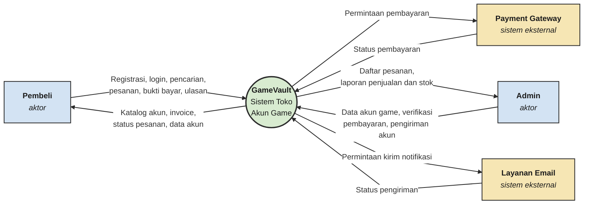

> Sprint 2 · **Context** | [Use Case](02-usecase.md) | [Sequence](03-sequence.md) | [Class](04-class.md) | [State](05-state.md) · [README](README.md)

# Context Diagram — GameVault

### 1.1 Tujuan
Menunjukkan GameVault sebagai satu sistem utuh beserta entitas eksternal yang berinteraksi dengannya dan aliran data di antaranya.

### 1.2 Diagram

### 1.3 Penjelasan Entitas Eksternal
| Entitas | Peran | Input ke sistem | Output dari sistem |
|---|---|---|---|
| Pembeli | Pengguna yang membeli akun | Registrasi, login, pencarian, checkout, bukti bayar, ulasan | Katalog, invoice, status pesanan, data akun |
| Admin | Pengelola toko | Data akun game, verifikasi pembayaran, pengiriman akun | Daftar pesanan, laporan penjualan dan stok |
| Payment Gateway | Layanan pembayaran pihak ketiga | Status pembayaran | Permintaan pembayaran |
| Layanan Email | Pengirim notifikasi | Status pengiriman | Permintaan kirim notifikasi |

### 1.4 Batas Sistem
- **Di dalam sistem:** katalog, keranjang, checkout, verifikasi, pengiriman akun, ulasan, laporan.
- **Di luar sistem:** server game resmi, proses di bank/e-wallet, penyedia email.
