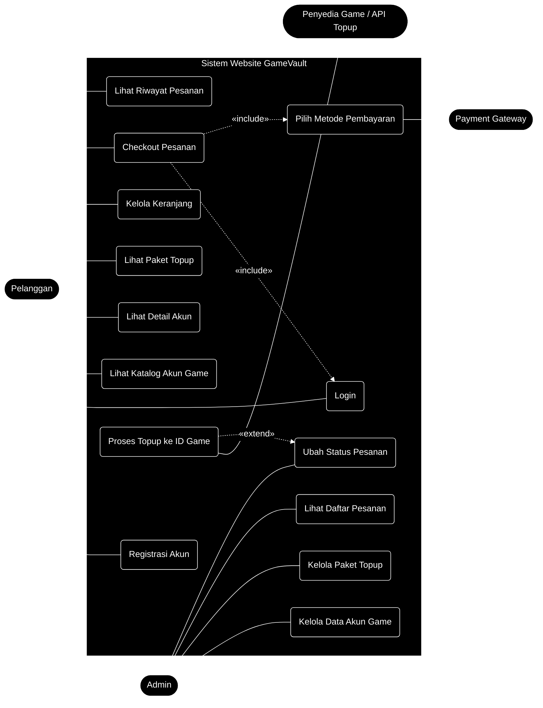
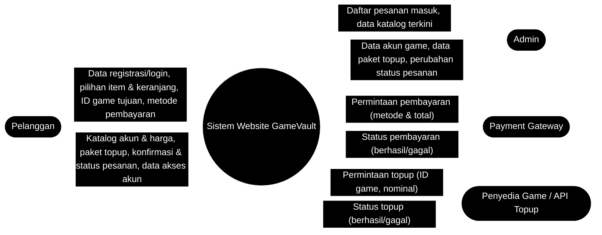
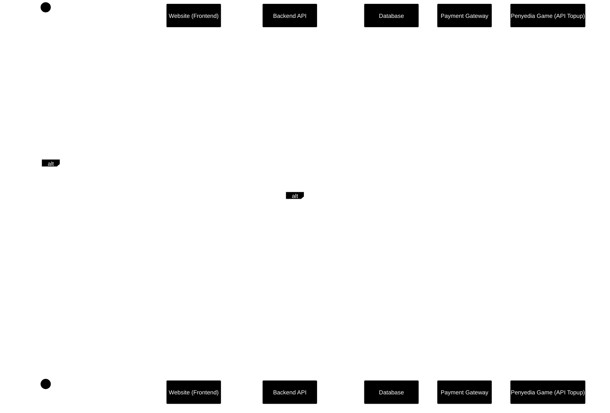
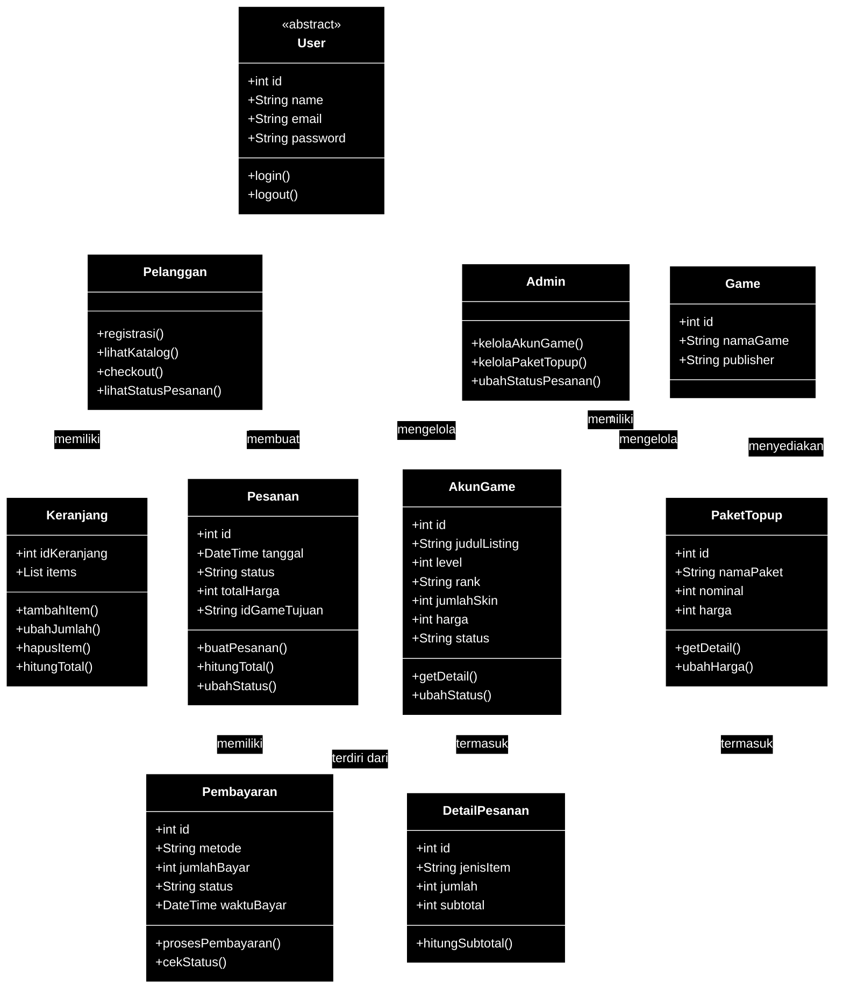

# 🎮 Dokumentasi Perancangan Sistem - GameVault

Dokumentasi ini merinci pemodelan sistem fungsional dan struktural dari platform **Digital Twin GameVault**, yaitu web store jual-beli **akun game online** dan **topup** yang dibangun berdasarkan pendekatan *Object-Oriented Analysis and Design (OOAD)*.

> 💡 **Catatan:** "GameVault" adalah nama placeholder. Silakan ganti sesuai nama proyek kelompok kamu. Diagram di bawah memakai sintaks **Mermaid** (otomatis tampil di GitHub/VS Code). Jika ingin versi gambar draw.io seperti dokumen sebelumnya, kamu bisa menggambar ulang berdasarkan penjelasan tiap bagian lalu mengganti blok Mermaid dengan tag ``.

---

## 0. Konsep Digital Twin pada Sistem

Sistem ini menjual dua jenis produk dengan sifat yang berbeda:

| Aspek | Akun Game Online | Topup |
|---|---|---|
| Sifat | **Objek / aset digital** | **Transaksi / layanan** |
| Isi | Karakter, level, rank, skin, item, progres | Penambahan mata uang game (diamond, UC, dll.) |
| Identitas unik | Ya (ID akun) | Tidak (hanya ID tujuan pengisian) |
| Menyimpan kondisi | Ya, terus berubah | Tidak, sekali proses |
| Peran sebagai *Digital Twin* | ✅ **Ya**, representasi digital dari identitas dan aset pemain | ❌ Bukan, hanya proses yang mengubah isi akun |

**Pada sistem ini**, setiap *listing* akun game di katalog berfungsi sebagai **kembaran digital (digital twin)** dari akun asli di dalam game: data seperti level, rank, jumlah skin, dan status ketersediaan disinkronkan dan ditampilkan sehingga pembeli dapat menilai akun tanpa harus membuka akun aslinya. Sedangkan **topup** diperlakukan sebagai layanan yang memodifikasi kondisi akun tersebut.

---

## 1. Use Case Diagram (Interaksi Pengguna dengan Sistem)

---

## 👥 A. Identifikasi Aktor (Actors)

Sistem ini melibatkan empat aktor dengan batas hak akses dan peran yang terdefinisi secara jelas:

*   **Pelanggan (*Primary Actor*)**: Pengguna akhir yang menjelajahi katalog akun game dan paket topup, mengelola keranjang, serta melakukan transaksi pembelian.
*   **Admin (*Secondary Actor*)**: Pengelola internal yang memperbarui data akun game dan paket topup, serta memantau dan memperbarui status pesanan masuk.
*   **Payment Gateway (*External Actor*)**: Sistem pihak ketiga (QRIS, E-Wallet, Transfer Bank) yang memproses dan mengesahkan pembayaran.
*   **Penyedia Game / API Topup (*External Actor*)**: Sistem pihak ketiga yang mengeksekusi pengisian mata uang game ke ID pemain setelah pembayaran terverifikasi.

---

## ⚙️ B. Pembongkaran Fungsionalitas (Use Cases)

### a. Fitur Spesifik Pelanggan
*   **Registrasi Akun:** Pendaftaran pengguna baru agar data kredensial tersimpan dalam basis data.
*   **Login:** Otentikasi pelanggan terdaftar untuk mengakses hak istimewa transaksi.
*   **Lihat Katalog Akun Game:** Menampilkan daftar akun game yang dijual beserta ringkasan (game, level, rank, harga).
*   **Lihat Detail Akun:** Menampilkan *digital twin* akun secara rinci: karakter/hero, skin, item langka, dan progres.
*   **Lihat Paket Topup:** Menampilkan daftar nominal topup per game beserta harganya.
*   **Kelola Keranjang:** Penampung pesanan sementara untuk menambah atau mengurangi item sebelum dibayar.
*   **Lihat Riwayat Pesanan:** Memantau status dan histori transaksi pelanggan.

### b. Fitur Spesifik Admin
*   **Kelola Data Akun Game:** Operasi tambah, ubah, hapus (*CRUD*) listing akun game, termasuk memperbarui status (tersedia/terjual).
*   **Kelola Paket Topup:** Operasi *CRUD* untuk paket nominal topup dan harganya.
*   **Lihat Daftar Pesanan:** Memantau antrean transaksi masuk secara *real-time*.
*   **Ubah Status Pesanan:** Memperbarui tahapan pesanan (menunggu → diproses → selesai), termasuk mengirim data akses akun kepada pembeli.

---

## 🔗 C. Analisis Logika Relasi Pembatas (`<<include>>` dan `<<extend>>`)

a.  **Checkout Pesanan `<<include>>` Login**
    *   *Analisis:* Pelanggan bebas melihat katalog dan mengelola keranjang. Namun sebelum `Checkout Pesanan`, sistem wajib memicu `Login`. Transaksi tidak dapat dilanjutkan jika pelanggan belum terverifikasi. Ini juga penting karena akun game bernilai tinggi dan perlu kejelasan identitas pembeli.
b.  **Checkout Pesanan `<<include>>` Pilih Metode Pembayaran**
    *   *Analisis:* Setelah checkout divalidasi, sistem otomatis mengarahkan pengguna ke `Pilih Metode Pembayaran`, yang sekaligus memicu keterlibatan aktor **Payment Gateway**.
c.  **Proses Topup ke ID Game `<<extend>>` Ubah Status Pesanan**
    *   *Analisis:* Langkah ini hanya berjalan **jika** item pesanan bertipe topup. Untuk pesanan akun game, langkah ini dilewati dan admin langsung mengirim data akses akun.

---

## 🔄 D. Penjelasan Runutan Logika Bisnis (Business Logic Flow)

*   **Fase Penjelajahan:** Pelanggan melihat katalog akun game, detail akun, dan paket topup.
*   **Fase Akumulasi:** Item pilihan dimasukkan ke keranjang. Untuk topup, pelanggan mengisi **ID game tujuan**.
*   **Fase Validasi Transaksi:** Saat checkout, sistem memeriksa login, lalu mengarahkan ke pemilihan metode pembayaran.
*   **Fase Pembayaran:** *Payment Gateway* mengesahkan pembayaran.
*   **Fase Pemenuhan Pesanan:**
    *   **Akun game:** status listing berubah menjadi *terjual* dan admin mengirim data akses akun ke pembeli.
    *   **Topup:** sistem meneruskan permintaan ke *Penyedia Game / API Topup* untuk mengisi ID tujuan, lalu status pesanan menjadi *selesai*.

---

## 2. Context Diagram (Batasan & Aliran Data Sistem)

Diagram konteks memandang seluruh sistem sebagai satu proses tunggal dan memetakan aliran data masuk dan keluar dari entitas luar (*terminator*).

---

## 👥 A. Entitas Luar (External Entities)

*   **Pelanggan**: Memberikan data masukan pesanan dan menerima informasi timbal balik.
*   **Admin**: Menyuplai data pengaturan katalog dan memperbarui progres layanan.
*   **Payment Gateway**: Memproses validasi transaksi keuangan secara otomatis.
*   **Penyedia Game / API Topup**: Mengeksekusi pengisian mata uang game ke ID pemain.

---

## 🔁 B. Aliran Data Masuk ke Sistem (Input Data Flows)

### a. Dari Pelanggan ke Sistem
*   **Data registrasi / login:** Kredensial akun pengguna untuk otentikasi.
*   **Pilihan item & keranjang:** Akun game atau paket topup yang dipilih.
*   **ID game tujuan:** Identitas akun pemain yang akan diisi (khusus topup).
*   **Metode pembayaran:** Jalur transaksi keuangan pilihan pelanggan.

### b. Dari Admin ke Sistem
*   **Data akun game (tambah/ubah/hapus):** Detail listing seperti game, level, rank, skin, harga, dan status.
*   **Data paket topup (tambah/ubah/hapus):** Nominal dan harga paket.
*   **Perubahan status pesanan:** Update tahapan pesanan (diproses/selesai).

### c. Dari Payment Gateway ke Sistem
*   **Status pembayaran (berhasil / gagal):** Respon sah atau tidaknya transaksi.

### d. Dari Penyedia Game ke Sistem
*   **Status topup (berhasil / gagal):** Respon hasil pengisian ke ID game tujuan.

---

## ↩️ C. Aliran Data Keluar dari Sistem (Output Data Flows)

### a. Dari Sistem ke Pelanggan
*   **Katalog akun game & harga:** Daftar akun beserta detail *digital twin*-nya.
*   **Daftar paket topup:** Nominal dan harga per game.
*   **Konfirmasi & status pesanan:** Nota transaksi dan progres pesanan.
*   **Data akses akun:** Informasi akses akun game yang telah dibeli (setelah pembayaran sah).

### b. Dari Sistem ke Admin
*   **Daftar pesanan masuk:** Rincian pesanan baru yang harus diproses.
*   **Data katalog terkini:** Basis data akun dan paket topup yang sedang aktif.

### c. Dari Sistem ke Payment Gateway
*   **Permintaan pembayaran (metode & total):** Nominal tagihan dan metode pilihan pelanggan.

### d. Dari Sistem ke Penyedia Game
*   **Permintaan topup (ID game & nominal):** Instruksi pengisian setelah pembayaran terverifikasi.

---

## 📌 D. Kesimpulan Batasan Sistem (System Boundary)

**Sistem Website GameVault** bertindak sebagai **jembatan informasi otomatis**. Sistem tidak memproses uang secara mandiri (dialihkan ke *Payment Gateway*), dan tidak mengisi mata uang game secara langsung (diteruskan ke *Penyedia Game*). Sistem hanya mengelola katalog, pesanan, dan alur datanya.

---

## 3. Sequence Diagram (Alur Proses Checkout & Pembayaran)

Sequence diagram menggambarkan urutan kronologis pesan pada proses checkout hingga pemenuhan pesanan.

---

## 🏗️ A. Komponen & Objek Sistem (Lifelines)

1.  **Pelanggan**: Aktor yang menginisiasi tindakan dan menerima respon visual.
2.  **Website (Frontend)**: Antarmuka tempat pengguna berinteraksi.
3.  **Backend API**: Logika bisnis yang memproses permintaan frontend dan menjembatani data.
4.  **Database**: Penyimpanan terpusat data pesanan, akun game, dan pembayaran.
5.  **Payment Gateway**: Pihak ketiga yang memvalidasi transaksi keuangan.
6.  **Penyedia Game (API Topup)**: Pihak ketiga yang mengeksekusi pengisian ke ID game.

---

## 🔄 B. Kronologi Urutan Alur Utama (Sequential Messages)

a.  **Klik Checkout**: `Pelanggan` menekan tombol checkout.
b.  **Tampilkan metode bayar**: `Frontend` menampilkan pilihan pembayaran.
c.  **Pilih metode, klik Bayar**: `Pelanggan` memilih metode (dan mengisi ID game bila topup).
d.  **POST /api/pesanan**: `Frontend` mengirim data transaksi ke `Backend API`.
e.  **INSERT pesanan (menunggu)**: `Backend API` menyimpan pesanan berstatus *menunggu pembayaran*.
f.  **Return id pesanan**: `Database` mengembalikan ID unik pesanan.
g.  **Minta pembayaran (total, metode)**: `Backend API` meminta otorisasi ke `Payment Gateway`.
h.  **Status pembayaran**: `Payment Gateway` mengirim hasil transaksi ke `Backend API`.

---

## 🔀 C. Analisis Percabangan Kondisi (Fragment Alt)

### Kondisi A: [pembayaran berhasil]
*   **9. UPDATE status -> diproses**: status pesanan berubah dari *menunggu* menjadi *diproses*.
*   **Cabang bersarang (alt):**
    *   *Item topup (10-12)*: `Backend API` meneruskan permintaan ke `Penyedia Game`, menerima statusnya, lalu mengubah pesanan menjadi *selesai*.
    *   *Item akun game (13)*: listing akun diubah menjadi *terjual* agar tidak dibeli ganda.
*   **14. Sukses + no pesanan** dan **15. Tampilkan konfirmasi**: pelanggan menerima konfirmasi keberhasilan.

### Kondisi B: [pembayaran gagal]
*   **16. Respon pembayaran gagal** dan **17. Tampilkan pesan gagal**: pelanggan diberi notifikasi agar dapat mencoba kembali.

---

## 4. Class Diagram (Struktur Objek & Basis Data)

---

## 🏛️ A. Struktur Kelas Utama dan Atribut (Classes & Attributes)

Sistem didukung oleh 10 kelas yang saling terhubung:

*   **User**: Super-class abstrak. *Atribut:* `id`, `name`, `email`, `password`. *Metode:* `login()`, `logout()`.
*   **Pelanggan**: Turunan User (konsumen). *Metode:* `registrasi()`, `lihatKatalog()`, `checkout()`, `lihatStatusPesanan()`.
*   **Admin**: Turunan User (pengelola). *Metode:* `kelolaAkunGame()`, `kelolaPaketTopup()`, `ubahStatusPesanan()`.
*   **Keranjang**: Wadah item sementara. *Atribut:* `idKeranjang`, `items`. *Metode:* `tambahItem()`, `ubahJumlah()`, `hapusItem()`, `hitungTotal()`.
*   **Game**: Master data game yang didukung. *Atribut:* `id`, `namaGame`, `publisher`.
*   **AkunGame** *(representasi Digital Twin)*: Listing akun yang dijual. *Atribut:* `id`, `judulListing`, `level`, `rank`, `jumlahSkin`, `harga`, `status` (tersedia/terjual). *Metode:* `getDetail()`, `ubahStatus()`.
*   **PaketTopup**: Layanan pengisian mata uang game. *Atribut:* `id`, `namaPaket`, `nominal`, `harga`. *Metode:* `getDetail()`, `ubahHarga()`.
*   **Pesanan**: Rekaman transaksi pembelian. *Atribut:* `id`, `tanggal`, `status`, `totalHarga`, `idGameTujuan` (khusus topup). *Metode:* `buatPesanan()`, `hitungTotal()`, `ubahStatus()`.
*   **DetailPesanan**: Kelas perantara rincian item. *Atribut:* `id`, `jenisItem` (akun/topup), `jumlah`, `subtotal`. *Metode:* `hitungSubtotal()`.
*   **Pembayaran**: Rekaman validasi keuangan. *Atribut:* `id`, `metode`, `jumlahBayar`, `status`, `waktuBayar`. *Metode:* `prosesPembayaran()`, `cekStatus()`.

---

## 🔗 B. Analisis Hubungan Pewarisan (Generalization / Inheritance)

*   **User** adalah *Parent Class*.
*   **Pelanggan** dan **Admin** adalah *Child Class* yang mewarisi atribut (`id`, `name`, `email`, `password`) dan fungsi (`login()`, `logout()`) dari User.

---

## 🔀 C. Hubungan Antar-Kelas dan Multiplisitas (Associations & Multiplicity)

*   **Pelanggan - Keranjang (`memiliki`)**: `1` ke `1`. Satu pelanggan hanya punya satu keranjang aktif.
*   **Pelanggan - Pesanan (`membuat`)**: `1` ke `1..*`. Satu pelanggan dapat membuat banyak pesanan.
*   **Admin - AkunGame (`mengelola`)**: `1` ke `1..*`. Satu admin mengelola banyak listing akun.
*   **Admin - PaketTopup (`mengelola`)**: `1` ke `1..*`. Satu admin mengelola banyak paket topup.
*   **Game - AkunGame (`memiliki`)**: `1` ke `0..*`. Satu game dapat memiliki banyak listing akun (atau belum ada).
*   **Game - PaketTopup (`menyediakan`)**: `1` ke `1..*`. Satu game menyediakan minimal satu paket topup.
*   **Pesanan - DetailPesanan (`terdiri dari`)**: `1` ke `1..*`. Satu pesanan wajib punya minimal satu rincian.
*   **AkunGame - DetailPesanan (`termasuk`)**: `1` ke `0..1`. Satu akun bersifat **unik**, sehingga hanya bisa tercatat pada satu rincian pesanan (tidak bisa dijual dua kali).
*   **PaketTopup - DetailPesanan (`termasuk`)**: `1` ke `0..*`. Satu paket topup dapat dibeli berulang kali oleh banyak pelanggan.
*   **Pesanan - Pembayaran (`memiliki`)**: `1` ke `1`. Satu pesanan dipasangkan dengan satu catatan pembayaran.

> 🔎 **Poin pembeda penting:** relasi `AkunGame` ke `DetailPesanan` bersifat `0..1` (barang unik, sekali jual), sedangkan `PaketTopup` bersifat `0..*` (layanan, bisa dibeli berulang). Perbedaan ini mencerminkan konsep bahwa akun game adalah *objek* (digital twin) dan topup adalah *transaksi*.

*Developed with 🎮 by Kelompok ___ - Rekayasa Perangkat Lunak*
