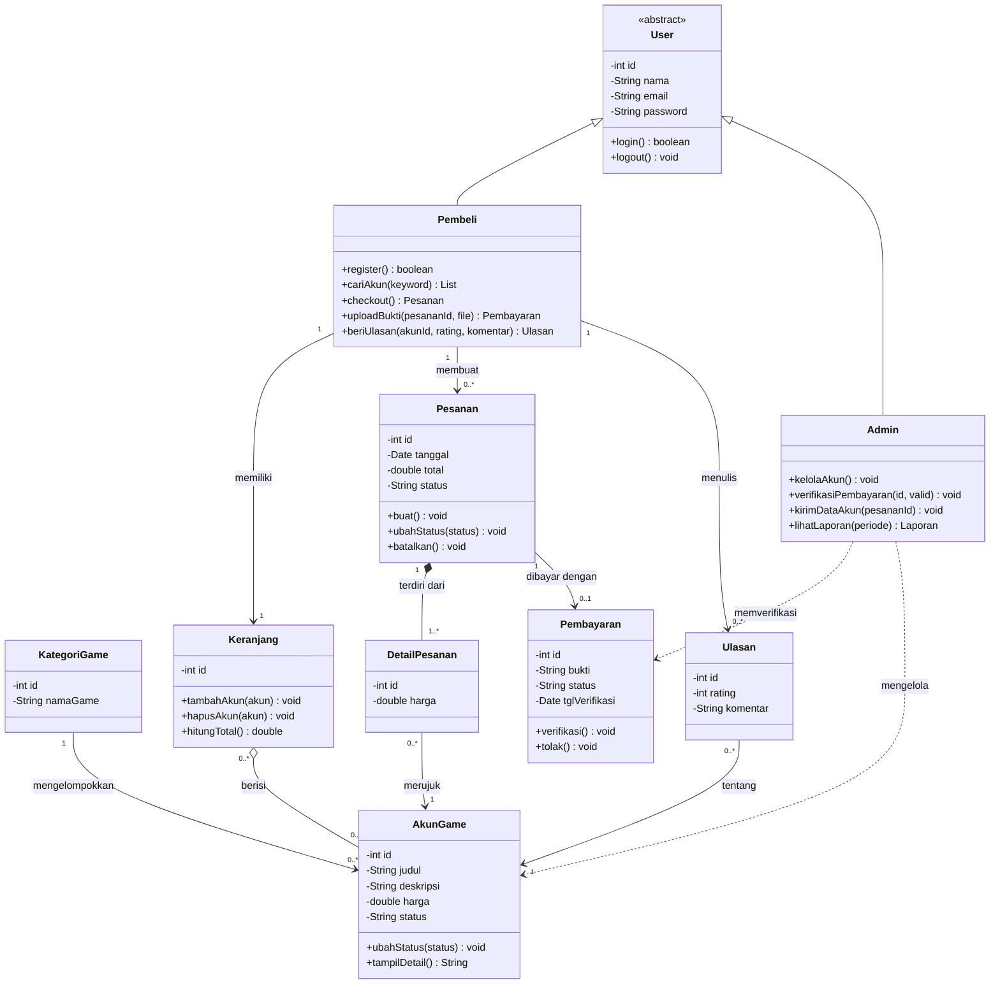

> Sprint 2 · [Context](01-context.md) | [Use Case](02-usecase.md) | [Sequence](03-sequence.md) | **Class** | [State](05-state.md) · [README](README.md)

# Class Diagram — GameVault

### 4.1 Diagram

### 4.2 Penjelasan Relationship
| Relasi | Jenis | Keterangan |
|---|---|---|
| User → Pembeli, Admin | Inheritance | Pembeli dan Admin mewarisi atribut login dari User |
| Pesanan ◆— DetailPesanan | Composition | DetailPesanan tidak bisa ada tanpa Pesanan |
| Keranjang ◇— AkunGame | Aggregation | Akun tetap ada di katalog meski keranjang dikosongkan |
| Pesanan → Pembayaran | Association (1 ke 0..1) | Pesanan baru punya pembayaran setelah bukti diunggah |
| Admin ⇢ Pembayaran | Dependency | Admin memakai Pembayaran untuk verifikasi |

Class di atas selaras dengan tabel pada ERD Sprint 1 (Users, Kategori_Game, Akun_Game, Keranjang, Pesanan, Detail_Pesanan, Pembayaran, Ulasan).
