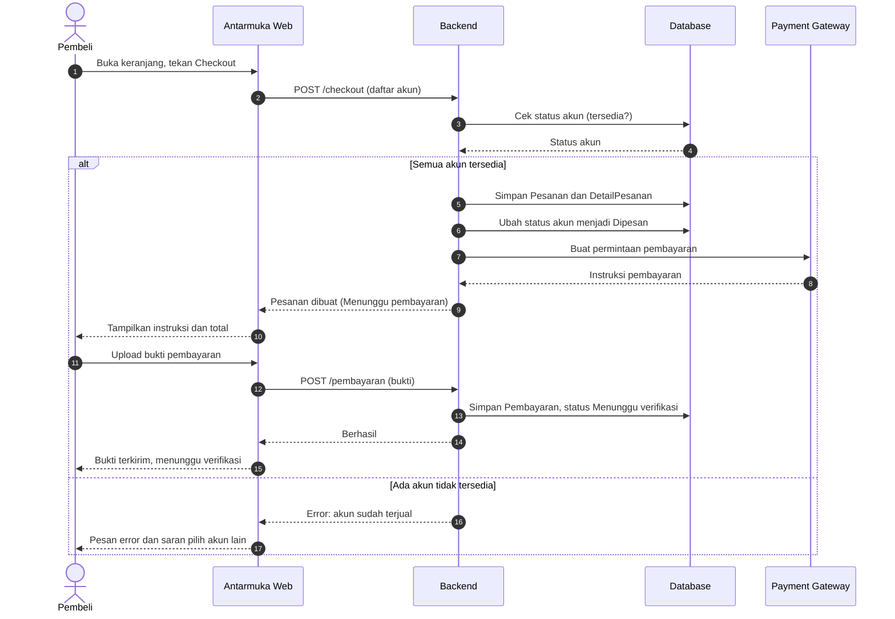
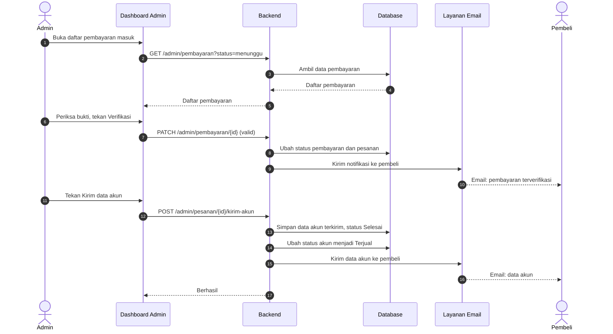
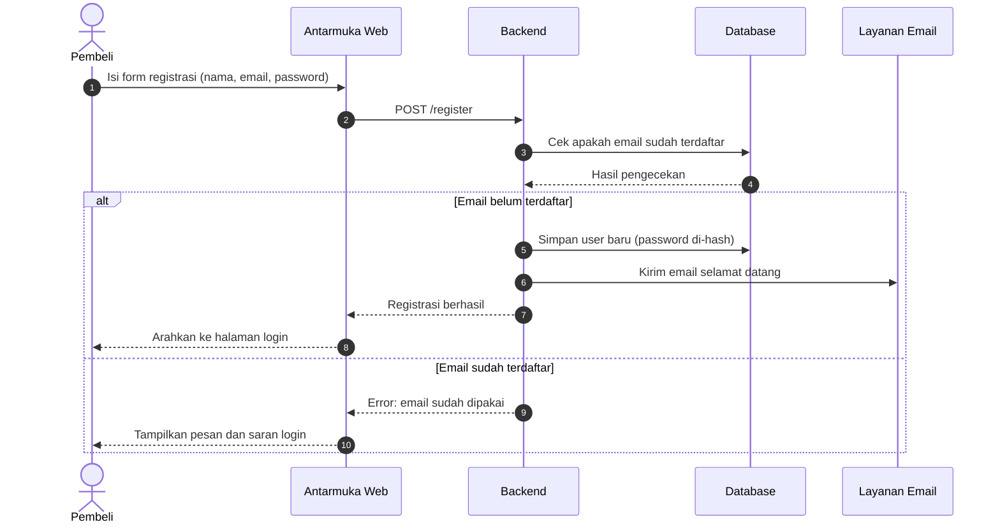
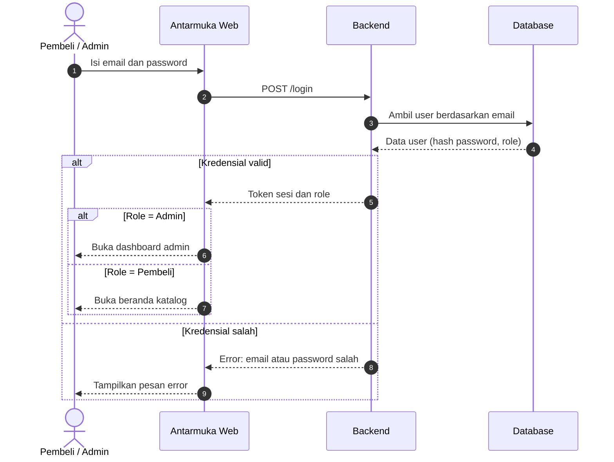
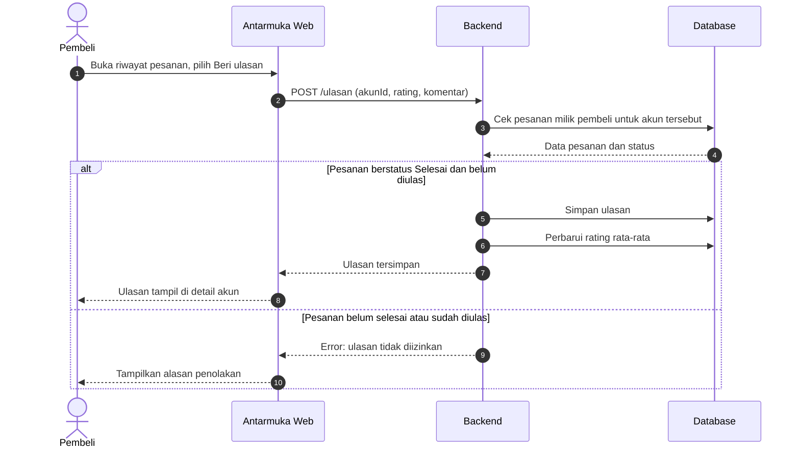

> Sprint 2 · [Context](01-context.md) | [Use Case](02-usecase.md) | **Sequence** | [Class](04-class.md) | [State](05-state.md) · [README](README.md)

# Sequence Diagram — GameVault

Sequence diagram menggambarkan **urutan pesan antar peserta** dalam satu skenario, dibaca dari atas ke bawah. Nomor pada tiap panah (autonumber) menunjukkan urutan kejadian. Panah penuh adalah permintaan, panah putus-putus adalah balasan, dan kotak `alt` adalah percabangan kondisi.

> Penjelasan tiap skenario ada di file terpisah: [03-sequence-penjelasan.md](03-sequence-penjelasan.md)

### 3.1 Skenario A: Pembelian dan Pembayaran oleh Pembeli

### 3.2 Skenario B: Verifikasi dan Pengiriman Akun oleh Admin

### 3.3 Skenario C: Registrasi Pembeli

### 3.4 Skenario D: Login (Pembeli dan Admin)

### 3.5 Skenario E: Beri Ulasan

